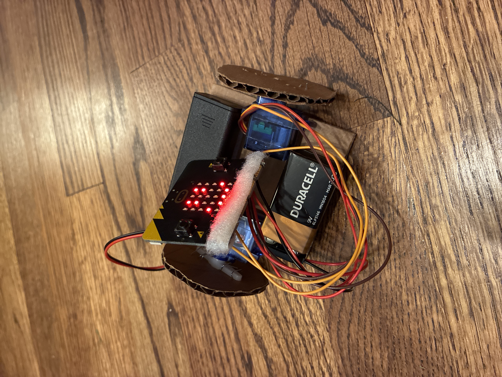
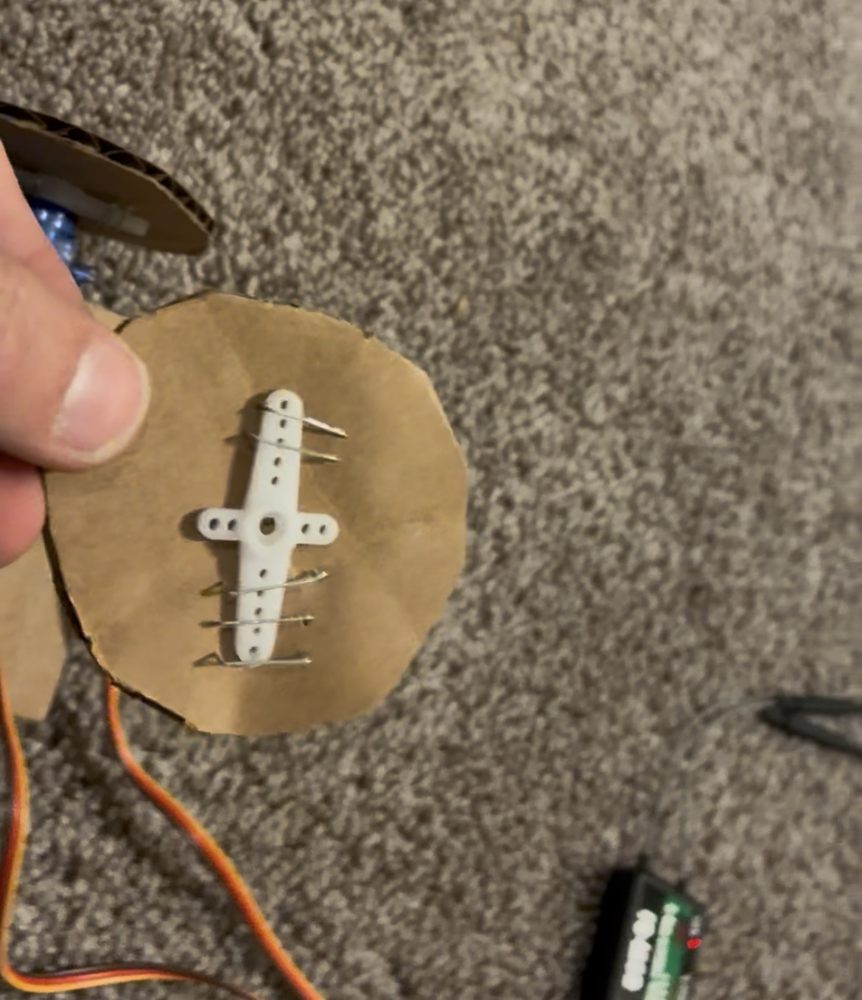
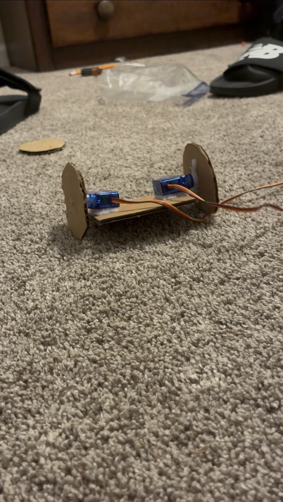
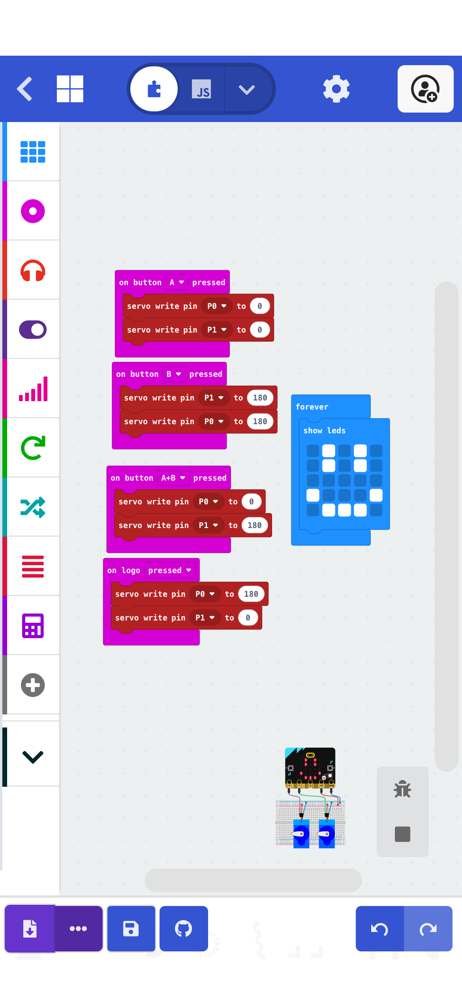

# BiDroid-DC

Description: 
A simple 2 wheeled robot powered by a microbit, 8v battery, and two continuous rotation servos. 

Features:
The DC (direct control) version is driven by the microbit mounted on it. It can go foward and backward and turn in place, it also has facial expressions. 

Hardware:
The motors, servos, 9v battery, and microbit battery pack all have hook enclosure velcro that corresponds to the velcro on the cardboard plate. The wheels are cardboad discs stapled to RC airplane servo horns.

Software:
Using microbit make code software, one button will turn the wheel opposite directions, the other will reverse that, both buttons make it go foward, and the touch sensing logo makes it go backward. The LEDs also always display a face.

Wiring:
collective ground to GND pin. collective positive (9v wired in) to 3v pin. Yellows to P0&P1

. 1 9v battery with adapter 

. Both sides of velcro

. Cardboard or poster boars 
